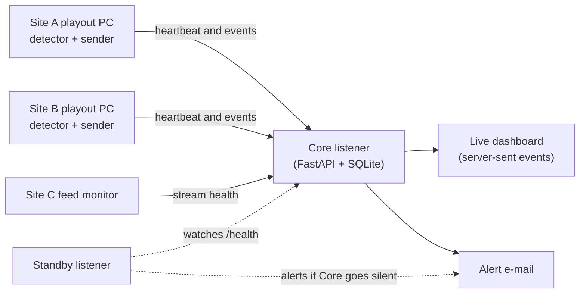

# Broadcast Watchdog

A watchdog for live TV playout. Small detector programs run next to each playout system, report a heartbeat and the events they notice (picture frozen, black, silence, a clip running late, the station off air), and a central listener turns those reports into a live dashboard and alerts.

It detects that a playout *engine* has stalled or gone quiet. It does not judge whether the picture is good.

> This repository is a cleaned showcase of a system that runs in production. Client names, server names, addresses, mailboxes and programme titles are replaced with placeholders (Site A, Site B, `example.com`, and so on). The tooling that deploys and operates the real servers is deliberately not included.

## How it fits together



- **Senders** (PowerShell, in `edge/`) post a heartbeat on a fixed interval and a classified event whenever something changes.
- **The listener** (`core-listener/`) keeps the latest state of every source, judges silence ("three missed heartbeats"), raises held alarms, serves the dashboard and sends e-mail.
- **A standby listener** can watch the primary and take over alerting if the primary itself goes quiet.

## What it does

- Per-source state: healthy, warning, critical, with the latest item playing and a progress bar.
- Alarm rules for frozen picture, black, silence, loudness, off air, a clip running past its expected end, and "nothing playing" for too long.
- A live dashboard for desktop and phone, with a siren that stays silent until someone taps, and an offline page that still opens when the network is down.
- Optional sections: AV matrix switching with an audit trail, a feed monitor for a carrier stream, and staff shifts with a "who is on it" record.

## Security design in brief

- **Two kinds of key.** Senders hold write keys. The public dashboard carries only a *derived* read key (an HMAC of the sender key), so the page can never be used to post data. Keys can be rotated without reloading an open dashboard.
- **Plain-http refusal.** The listener can refuse posts that arrive over plain http from the public internet.
- **Request guards.** Size, rate and shape limits on every write, a hostile-input test suite, and a constant-time key comparison.
- **Hardened container.** Non-root user, read-only filesystem, all Linux capabilities dropped, memory and process limits, and dependencies installed only from a hash-locked file.
- **A startup grace period** stops a listener restart from raising false "heartbeat lost" alarms.

## Repository layout

| Path | What it holds |
| --- | --- |
| `core-listener/` | The listener service, its Dockerfile and compose file, and the hash-locked dependency set |
| `edge/` | The PowerShell senders and their tests |
| `docs/` | A short architecture summary: the design ideas, not any one installation |
| `ops/` | The test suites (`ops/test_*.py`), browser tests (`ops/browser_tests`) and small helpers |
| `.github/` | The CI workflow and dependency updates |

## Running the tests

```bash
python ops/test_listener_units.py     # the listener's unit tests
python ops/test_hostile_input_live.py # real HTTP against a throwaway listener, hostile input
python ops/test_edge_senders.py       # the PowerShell sender tests (needs Windows PowerShell)
```

The workflow in `.github/workflows/ci.yml` runs the whole set on every pull request, plus a dependency audit (pip-audit), static analysis (bandit), a secrets scan (gitleaks) and a container build.

## Status

Provided as a reference and portfolio piece. Licensed under the Apache License, Version 2.0: see [LICENSE](LICENSE) and [NOTICE](NOTICE).
